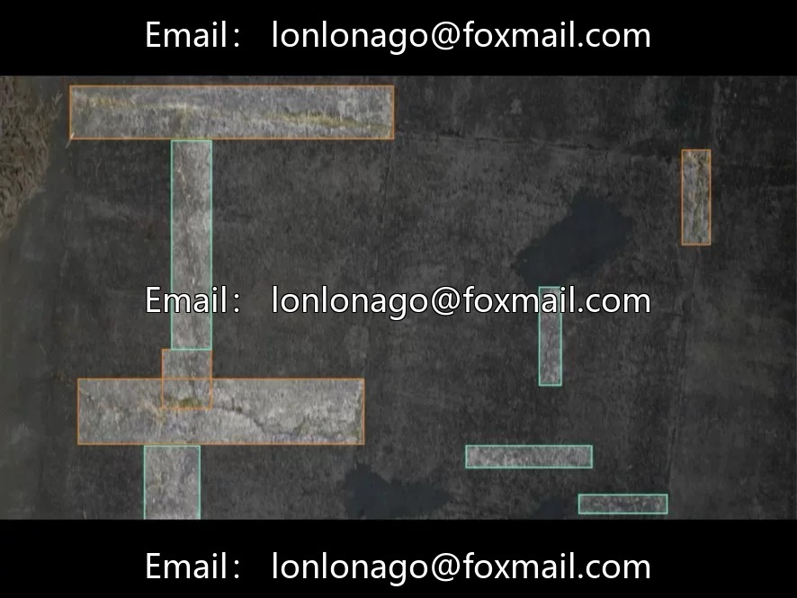
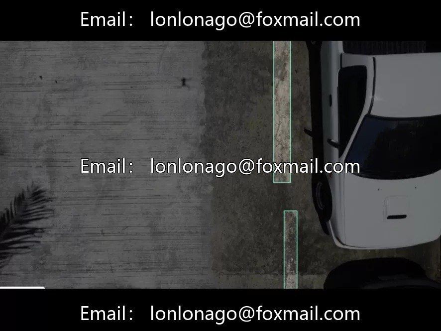
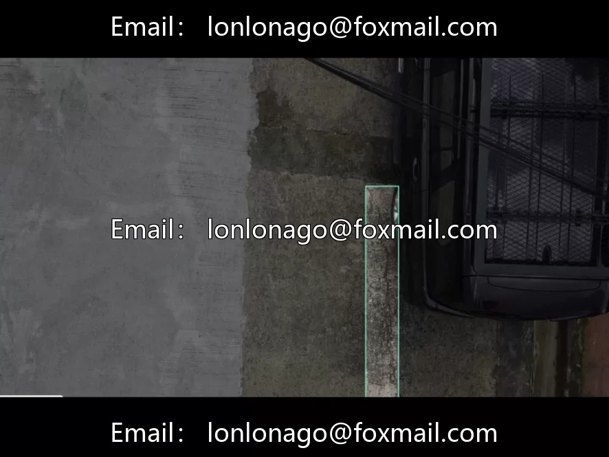

# Drone inspection dataset of road surface defects

## Body

UAV inspection dataset for pavement defects - cement road surface defect inspection dataset | 1000 categories, low-altitude AI recognition of pits and holes

1000 drone aerial photos in YOLO format, three categories - horizontal defects, vertical defects, pits. Low-altitude bird's eye view, covering real interference scenes such as backlighting, shadows, and obstructions by debris.

Application scenarios are very direct: road pit inspection, cement pavement crack detection, and municipal road disease survey. Drones replace manual on-road inspections, with high efficiency and no impact on traffic.

Data characteristics: The tweets state that the ineffective images with blurred or severe occlusion have been removed, ensuring a certain level of quality assurance for annotation. However, the information is quite brief—it does not provide specific sample quantities for various categories, resolutions, or whether training, validation, and test sets have been divided. From the training code, it appears that the image size is set to 640, batch size is 8, and early stopping is implemented after 26 rounds. The approach is relatively lightweight and aims for rapid validation.

Notes for small data volume: 1000 images divided into three categories, each about 300 images, which is a relatively small dataset. If the distribution of three categories is uneven (e.g., fewer pits and more cracks), attention should be paid to handling the imbalance during training. It is recommended to enhance generalization capabilities by conducting data augmentation. This is suitable for rapid validation in small-scale scenarios or as a supplement to existing road surface inspection datasets. For comprehensive road defect data, refer back to my previous post on "Road Crack Dataset".

Virtual materials, once sold, are non-refundable.
Interested friends, click "I want" to proceed.

## Images

## Payment

Here is a pay link on Stripe ( https://buy.stripe.com/3cs8yP7sY87d0vu9AB ). Please contact me lonlonago@foxmail.com after funding $89, and I will send you a complete data files , thank you!

